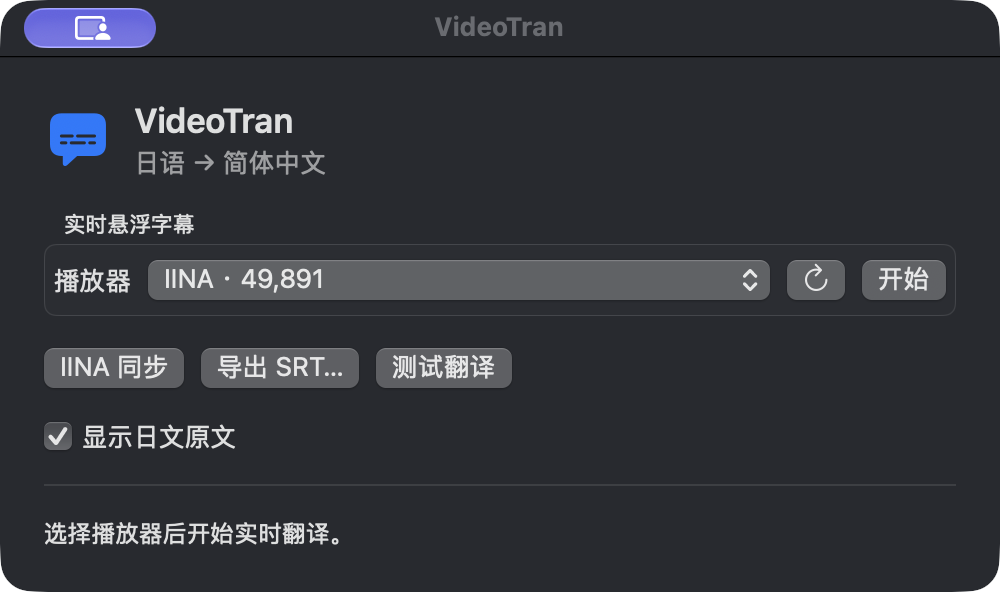

English | [简体中文](README.zh-CN.md)

# VideoTran

On-device Japanese-to-Simplified Chinese subtitles for **Apple silicon Macs**.

[](https://github.com/MarkYang44/VideoTran/releases/latest)


**[Download macOS arm64 DMG](https://github.com/MarkYang44/VideoTran/releases/download/v0.1.0/VideoTran-0.1.0-macOS-arm64.dmg)** · [IINA plugin](https://github.com/MarkYang44/VideoTran/releases/latest/download/VideoTran.iinaplgz) · [All releases](https://github.com/MarkYang44/VideoTran/releases)

## Overview

VideoTran can caption the audio from a selected player, keep translated subtitles aligned with playback in IINA, or export an SRT file. Speech recognition and translation run on the Mac. The current app and plugin interface is in Simplified Chinese.

## Screenshots

**VideoTran control center**. Captured from the macOS app.

[](docs/screenshots/control-center.png)

## Core features

| Mode | How it works |
| --- | --- |
| Live captions | Captures audio from the selected player and displays a floating caption window on the screen under the pointer. |
| IINA Sync | Uses IINA's playback position to display translated captions. It translates existing Japanese text subtitles first, or reads ahead in the audio when needed. |
| SRT export | Generates Simplified Chinese subtitles with timestamps for use in another player. |

Enable **显示日文原文** to display Japanese alongside the translation. You can minimize the control window while a task runs. Closing it stops the task.

## Installation

1. Open the DMG and drag **VideoTran** to Applications.
2. For IINA Sync, open the matching `VideoTran.iinaplgz` package and follow IINA's installation prompt.
3. When prompted, download the Japanese and Simplified Chinese language packs.

The release targets **macOS 15 or later** on Apple silicon. The app is ad hoc signed and has yet to be notarized by Apple. Each release includes a `SHA256SUMS.txt` file.

## Quick start

1. **Live captions.** Play a video, select its player in VideoTran, and click **开始**. Grant macOS system audio recording permission when prompted.
2. **IINA Sync.** Open a local video in IINA and choose **插件 → 同步翻译此窗口**. In VideoTran, click **IINA 同步**.
3. **SRT export.** Click **导出 SRT…**, choose a video, and select where to save the subtitle file.

## Compatibility and dependencies

- **Formats.** IINA Sync and SRT export accept MP4, MKV, MOV, M4V, and WebM. VideoTran looks for Japanese-tagged embedded text subtitles and sidecar files named `video.ja.srt`, `video.jpn.srt`, or `video.ja-JP.srt`.
- **FFmpeg.** Install with `brew install ffmpeg` for IINA Sync, SRT export, or live captions using Whisper.
- **Speech recognition.** Apple Speech is available on macOS 26 or later. To use Whisper, install `whisper-cpp` and place `ggml-large-v3.bin` or `ggml-large-v3-turbo.bin` in `~/Library/Application Support/VideoTran/`. You can also set the absolute paths through `VIDEO_SUBTITLE_WHISPER` and `VIDEO_SUBTITLE_MODEL`. [Whisper models](https://github.com/ggml-org/whisper.cpp/blob/master/models/README.md)
- **Translation.** Apple Translation generates Simplified Chinese. Existing Japanese text subtitles can be translated without downloading a speech recognition model.

Recognition quality depends on audio volume, background sound, and overlapping speech. Live mode may skip dialogue when processing falls behind. IINA Sync handles one window at a time, and seeking into unprocessed audio can delay the next caption.

## Development

Build on an Apple silicon Mac with Xcode 26 or the corresponding Command Line Tools. Node.js is required for the plugin tests.

```sh
./Scripts/build-app.sh
swift run SubtitleCoreTests
node Tests/iina-plugin-test.cjs
```

Build output goes to `dist/`. Live audio capture was verified with IINA 1.4.4, QuickTime Player, and VLC 3.0.24 on macOS 27.0.1. See the [validation notes](docs/implementation-plan.md) for the test scope or [open an issue](https://github.com/MarkYang44/VideoTran/issues) to report a problem.
