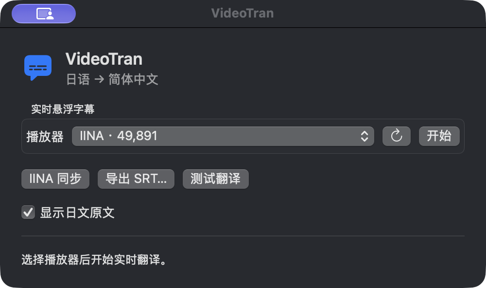

[English](README.md) | 简体中文

# VideoTran

适用于 **Apple silicon Mac** 的本地日语 → 简体中文字幕工具。

[](https://github.com/MarkYang44/VideoTran/releases/latest)


**[下载 macOS arm64 DMG](https://github.com/MarkYang44/VideoTran/releases/download/v0.1.0/VideoTran-0.1.0-macOS-arm64.dmg)** · [IINA 插件](https://github.com/MarkYang44/VideoTran/releases/latest/download/VideoTran.iinaplgz) · [全部版本](https://github.com/MarkYang44/VideoTran/releases)

## 概览

VideoTran 可以为选中播放器的音频生成悬浮字幕，也可以在 IINA 中按播放进度显示译文，或者导出 SRT 文件。语音识别与翻译均在本机运行。当前 App 和插件界面为简体中文。

## 界面截图

**VideoTran 控制台**。截图来自实际运行的 macOS 应用。

[](docs/screenshots/control-center.png)

## 核心功能

| 模式 | 工作方式 |
| --- | --- |
| 实时悬浮字幕 | 捕获所选播放器的音频，在鼠标所在屏幕显示悬浮字幕。 |
| IINA 同步 | 根据 IINA 的播放位置显示译文。优先翻译已有日文文本字幕，否则预读音轨。 |
| SRT 导出 | 生成带时间戳的简体中文字幕，可在其他播放器中加载。 |

勾选「显示日文原文」即可同时查看原文和译文。任务进行中可以最小化控制台，关闭窗口会停止当前任务。

## 下载与安装

1. 打开 DMG，将 **VideoTran** 拖到「应用程序」。
2. 如需 IINA 同步，打开同版本的 `VideoTran.iinaplgz`，按 IINA 提示安装。
3. 首次使用时，按系统提示下载日语和简体中文语言包。

发行版面向运行 **macOS 15 或更新版本**的 Apple silicon Mac。应用使用 ad hoc 签名，尚未经过 Apple 公证。Release 提供 `SHA256SUMS.txt` 校验文件。

## 快速开始

1. **实时字幕。** 播放视频，在 VideoTran 中选中播放器，点击「开始」。按 macOS 提示授权系统音频录制。
2. **IINA 同步。** 在 IINA 打开本地视频，选择「插件 → 同步翻译此窗口」，再在 VideoTran 中点击「IINA 同步」。
3. **SRT 导出。** 点击「导出 SRT…」，选择视频和字幕保存位置。

## 兼容性与依赖

- **文件格式。** IINA 同步和 SRT 导出支持 MP4、MKV、MOV、M4V 和 WebM。VideoTran 会查找带日语标记的内嵌文本字幕，以及 `影片名.ja.srt`、`影片名.jpn.srt`、`影片名.ja-JP.srt`。
- **FFmpeg。** IINA 同步、SRT 导出和 Whisper 实时转写需要 FFmpeg。可运行 `brew install ffmpeg` 安装。
- **语音识别。** macOS 26 或更新版本可使用 Apple Speech。使用 Whisper 时，安装 `whisper-cpp`，将 `ggml-large-v3.bin` 或 `ggml-large-v3-turbo.bin` 放入 `~/Library/Application Support/VideoTran/`。也可用 `VIDEO_SUBTITLE_WHISPER` 和 `VIDEO_SUBTITLE_MODEL` 指定绝对路径。[Whisper 模型下载说明](https://github.com/ggml-org/whisper.cpp/blob/master/models/README.md)
- **翻译。** 使用 Apple Translation 生成简体中文。有日文文本字幕时，可直接翻译字幕。

识别效果受音量、背景声和对白重叠影响。实时模式处理不过来时可能漏句。IINA 同步一次处理一个窗口，跳到尚未处理的位置时可能需要等待。

## 开发与验证

在 Apple silicon Mac 上使用 Xcode 26 或对应的 Command Line Tools 构建。插件测试需要 Node.js。

```sh
./Scripts/build-app.sh
swift run SubtitleCoreTests
node Tests/iina-plugin-test.cjs
```

构建产物位于 `dist/`。实时音频捕获已在 macOS 27.0.1 上使用 IINA 1.4.4、QuickTime Player 和 VLC 3.0.24 验证。详见[验收记录](docs/implementation-plan.md)，也可[提交问题](https://github.com/MarkYang44/VideoTran/issues)。
